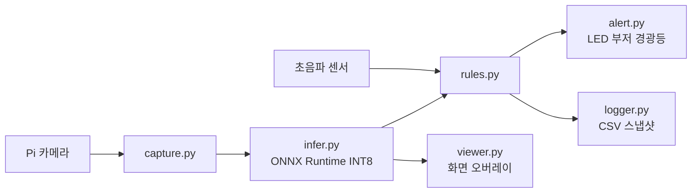

# 시스템 구성도 (예시)

> 프로젝트 1 · 현장 안전 모니터링 온디바이스 AI  
> Day 1 · 11.25(수) · 제출: Day 1 8교시

**이 문서는 작성 예시입니다. 조 이름, 수치, 파일명은 형식을 보여 주기 위한 가상 값입니다.**

| 조 | 작성자 | 작성일 |
| --- | --- | --- |
| 0조 (예시) | 조원 F | 11.25(수) |

## 구성도

## 모듈

| 모듈 | 파일 | 입력 | 출력 | 담당 |
| --- | --- | --- | --- | --- |
| 캡처 | capture.py | 카메라 | BGR 프레임 640×480 | 조원 E |
| 추론 | infer.py | 프레임 | 박스 목록 (클래스, 점수, 좌표) | 조원 D |
| 규칙 | rules.py | 박스 목록, 구역 좌표 | 상태 (정상/주의/위반) | 조원 A |
| 경보 | alert.py | 상태 | GPIO 출력 | 조원 E |
| 기록 | logger.py | 상태, 프레임 | CSV, 스냅샷 | 조원 F |
| 화면 | viewer.py | 프레임, 박스, 상태 | 모니터 표시 | 조원 F |

## GPIO 핀 계획

| 부품 | BCM 핀 | 방향 | 비고 |
| --- | --- | --- | --- |
| 녹색 LED | 17 | 출력 | 정상 |
| 황색 LED | 27 | 출력 | 주의 |
| 적색 LED | 22 | 출력 | 위반 |
| 능동 부저 | 18 | 출력 |   |
| 릴레이(경광등) | 23 | 출력 | 별도 전원 |
| LCD1602 (I2C) | 2, 3 | I2C | SDA, SCL |

## 설계 메모

박스는 `(cls, score, x1, y1, x2, y2)` 튜플 목록으로 통일합니다. 좌표는 원본 프레임 기준 픽셀입니다. 캡처와 추론은 스레드를 나누고 최신 프레임만 사용합니다.
