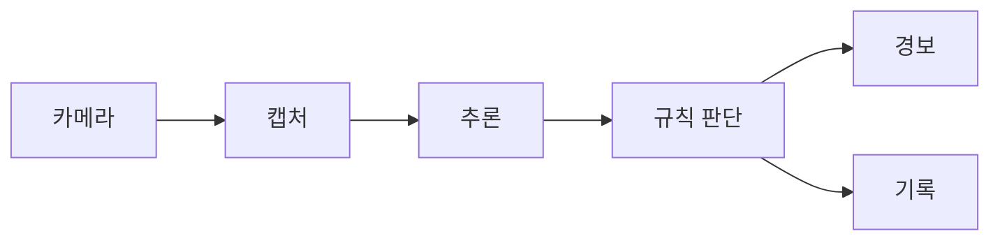

# 시스템 구성도 (양식)

> 프로젝트 1 · 현장 안전 모니터링 온디바이스 AI  
> Day 1 · 11.25(수) · 제출: Day 1 8교시

카메라에서 경보까지 데이터가 흐르는 길과 모듈별 담당을 한 장에 정리합니다. 그림은 Mermaid로 작성하면 GitHub와 Notion에서 바로 그려집니다.

| 조 | 작성자 | 작성일 |
| --- | --- | --- |
|   |   |   |

## 구성도

_작성 안내: 아래 뼈대를 조의 구조에 맞게 고칩니다._

## 모듈

| 모듈 | 파일 | 입력 | 출력 | 담당 |
| --- | --- | --- | --- | --- |
|   |   |   |   |   |
|   |   |   |   |   |
|   |   |   |   |   |
|   |   |   |   |   |
|   |   |   |   |   |

## GPIO 핀 계획

| 부품 | BCM 핀 | 방향 | 비고 |
| --- | --- | --- | --- |
|   |   |   |   |
|   |   |   |   |
|   |   |   |   |
|   |   |   |   |
|   |   |   |   |

## 설계 메모

_작성 안내: 모듈 사이에 주고받는 데이터 형식, 스레드 구조 등 합의한 내용을 적습니다._

(여기에 작성)
